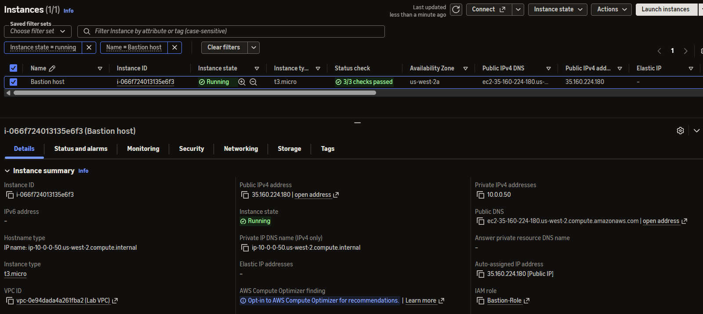
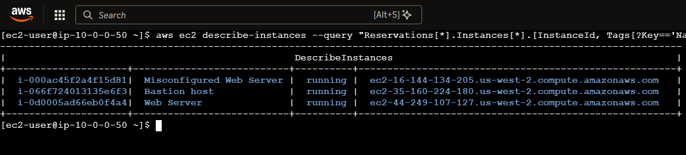
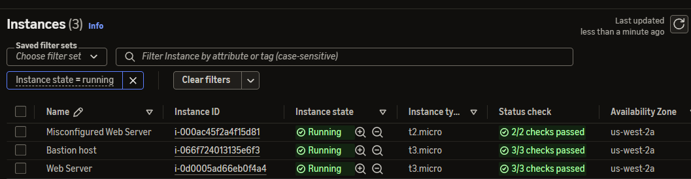
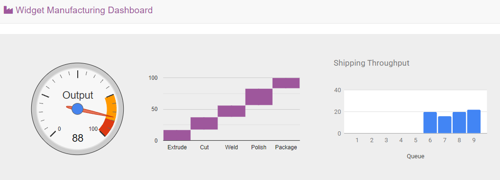
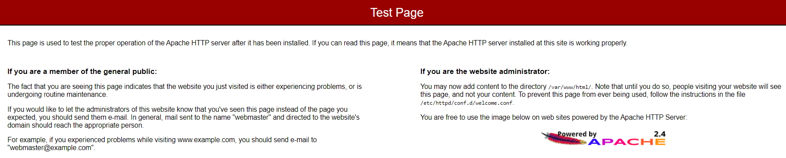

# Lab 8 - Lab 171 - Criação de Instâncias do Amazon EC2

## Visão geral

Neste laboratório, pratiquei o lançamento e o gerenciamento de instâncias do Amazon EC2 utilizando tanto o Console de Gerenciamento da AWS quanto a AWS Command Line Interface (AWS CLI). Também configurei um host bastion com permissões via IAM Role, publiquei um servidor web de forma automatizada com script de inicialização (User Data) e realizei o diagnóstico e correção de problemas de rede e serviço em uma instância adicional.

## Atividades realizadas

### 1. Criação e configuração do Host Bastion no Console da AWS

Iniciei uma instância `t3.micro` com Amazon Linux 2 dentro da rede `Lab VPC`, configurando um Security Group para permitir conexões SSH e associando o perfil de instância IAM `Bastion-Role`. Essa configuração permite que o host bastion execute comandos da AWS CLI de forma segura, sem a necessidade de armazenar chaves de acesso fixas no servidor.

### 2. Conexão segura e consulta de recursos via AWS CLI

Conectei-me ao terminal Linux do host bastion utilizando o EC2 Instance Connect diretamente pelo navegador. A partir dessa sessão, recuperei a região ativa pelos metadados da instância, consultei o ID da AMI mais recente no AWS Systems Manager Parameter Store, identifiquei a sub-rede pública e o grupo de segurança da web, e listei as instâncias ativas na conta com o comando `aws ec2 describe-instances`.

### 3. Lançamento do Servidor Web via AWS CLI

Utilizei o comando `aws ec2 run-instances` informando os parâmetros recuperados anteriormente e passando o script `UserData.txt` para instalar e configurar automaticamente o servidor web durante a inicialização da instância `Web Server`. Na visão geral do EC2, confirmei todas as instâncias do laboratório em execução (`running`) e com as verificações de integridade aprovadas.

### 4. Validação do Servidor Web no navegador

Após aguardar a instância atingir o estado `running`, recuperei o DNS IPv4 público pela CLI e acessei a aplicação web em uma nova aba do navegador, confirmando que o painel *Widget Manufacturing Dashboard* foi implantado corretamente pelo script de User Data.

### 5. Resolução de problemas de acesso e serviço (Desafios Opcionais)

Realizei o diagnóstico na instância `Misconfigured Web Server`, corrigindo as configurações de rede e do serviço Apache para permitir o acesso administrativo e a exibição da página padrão do servidor web pelo DNS público no navegador.

## O que aprendi

- Criar e configurar instâncias do Amazon EC2 pelo Console de Gerenciamento da AWS.
- Associar uma IAM Role (Instance Profile) a uma instância EC2 para executar comandos da AWS CLI com segurança.
- Conectar-se a instâncias Linux utilizando o EC2 Instance Connect sem gerenciar pares de chaves locais.
- Consultar parâmetros atualizados de AMI no AWS Systems Manager Parameter Store.
- Automatizar o lançamento e a configuração de servidores web com AWS CLI e scripts de User Data.
- Diagnosticar e solucionar problemas de conectividade e publicação de páginas web em instâncias EC2.

## Página do projeto

**[Acessar GitHub Pages](https://brunogacarvalho.github.io/lab-171-criacao-instancias-ec2/)**

A página apresenta um resumo do laboratório e flashcards interativos para revisar os principais conceitos.

## Créditos

Laboratório realizado durante a formação em Computação em Nuvem (AWS re/Start) da **Escola da Nuvem**.

- Professor: [Raphael Ohlsen](https://linkedin.com)
- Instituição: [Escola da Nuvem](https://escoladanuvem.org) | [LinkedIn da Escola da Nuvem](https://linkedin.com)
